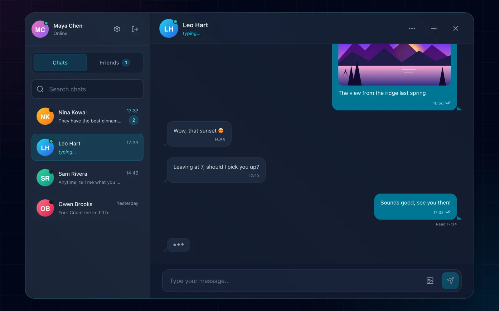
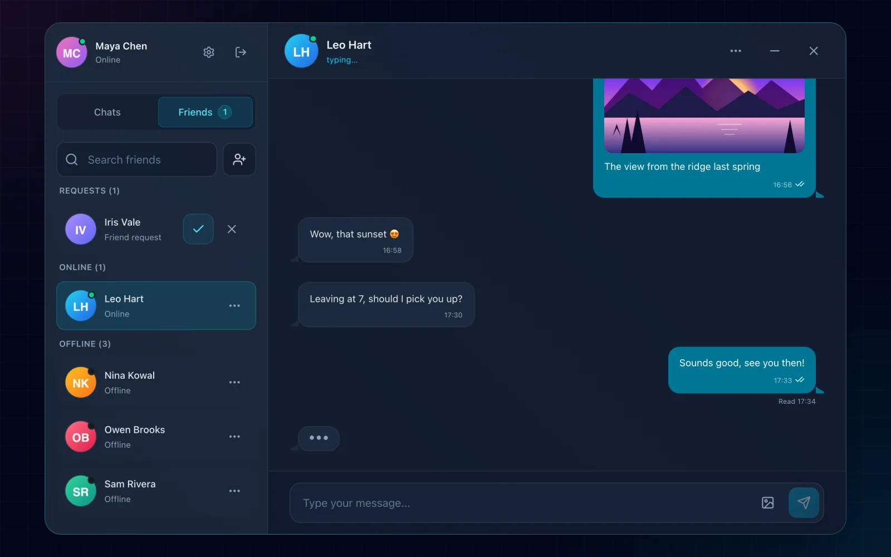
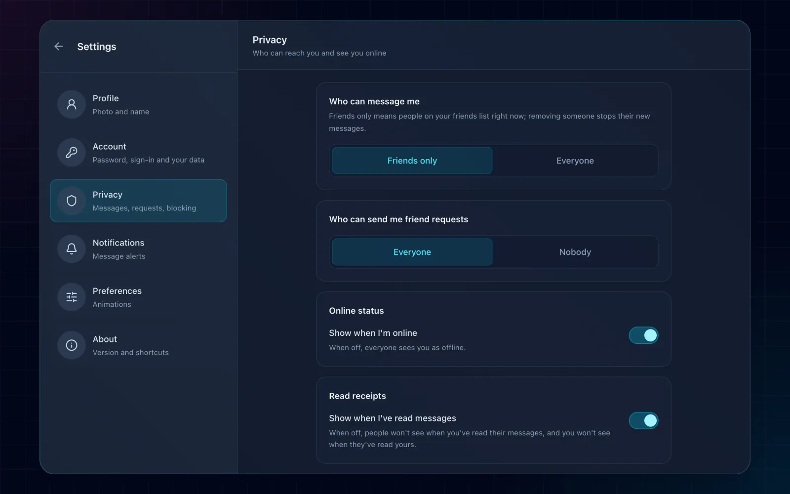
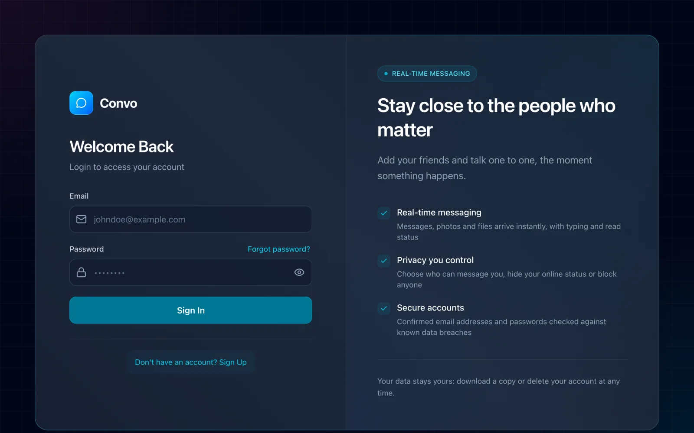
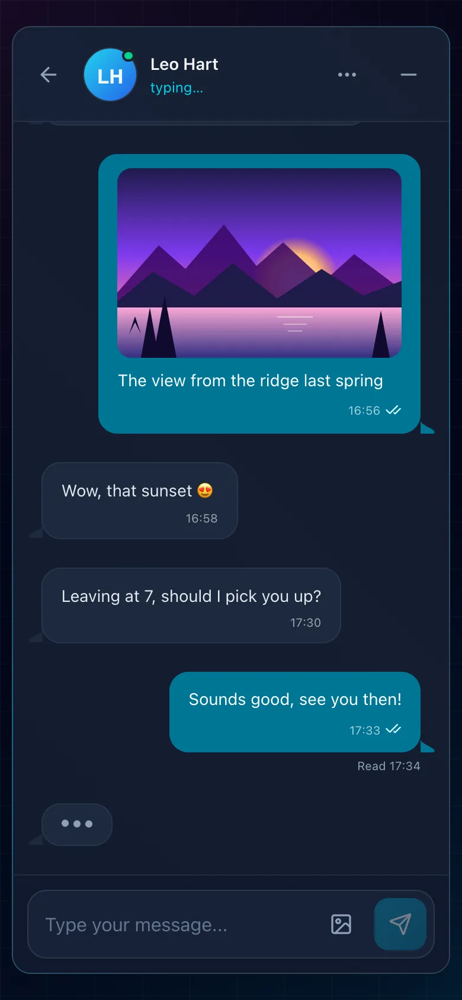

<div align="center">


# Convo

**Real-time, one-to-one messaging for friends.**<br>
A full-stack portfolio project: React and TypeScript, Express and Socket.IO, MongoDB.

[](https://convo.deezby.pl)
[](CHANGELOG.md)


[**Open the app**](https://convo.deezby.pl) · [Changelog](CHANGELOG.md) · [Deployment](DEPLOYMENT.md) · [Backend](backend/README.md) · [Frontend](frontend/README.md)

<br>



</div>

## ✨ Features

| Area | What you get |
| --- | --- |
| 💬 **Messaging** | Messages and photos arrive instantly, with typing indicators, online status and read receipts. Edit a message for 15 minutes, delete it for yourself or for everyone. Older history loads as you scroll up. |
| 👥 **Friends** | Search people, send and accept friend requests, block anyone. |
| 🗂️ **Chats** | Search, mute, hide or delete conversations; unread badges everywhere. |
| 🔒 **Privacy** | Choose who can message you and send you requests, hide your online status, turn read receipts off (for both sides). |
| 🛡️ **Accounts** | Email confirmation, password reset by email, email change with a confirmation link, one active session, passwords checked for strength and against known data breaches. |
| 📦 **Your data** | Download everything as JSON or delete the account at any time. |
| 🚀 **Releases** | The app shows its version and offers a reload when a newer one is deployed. |

## 📸 Screenshots

<table>
  <tr>
    <td width="50%"></td>
    <td width="50%"></td>
  </tr>
  <tr>
    <td align="center"><sub>Friends and requests, grouped by who's online</sub></td>
    <td align="center"><sub>Privacy settings</sub></td>
  </tr>
  <tr>
    <td></td>
    <td align="center"></td>
  </tr>
  <tr>
    <td align="center"><sub>Sign-in</sub></td>
    <td align="center"><sub>On a phone</sub></td>
  </tr>
</table>

## 🧱 Tech stack

| Layer | Built with |
| --- | --- |
| **Frontend** | React 19, TypeScript 6, Vite 8, Tailwind CSS 4, Zustand 5, React Router 8 |
| **Backend** | Node.js 24, Express 5, Socket.IO 4, Mongoose 9 (MongoDB 7), zod 4 |
| **Email** | Resend |
| **Tests** | Vitest and Testing Library; node:test, with integration tests on a real, throwaway MongoDB |
| **Production** | One Docker image behind Traefik on a VPS, a MongoDB container, daily backups |

## 🏗️ Architecture

- **Backend** ([backend/src](backend/src)): [server.js](backend/src/server.js) connects to MongoDB, starts HTTP and Socket.IO, runs data migrations and shuts down gracefully. [app.js](backend/src/app.js) wires Helmet, CORS, CSRF, request IDs, logging, `/healthz`, `/readyz`, uploaded files under `/uploads` and the routes under `/api/v1` (`/auth`, `/users`, `/messages`, `/friends`); in production it also serves the built frontend. [config/socket.js](backend/src/config/socket.js) runs Socket.IO with one room per user, presence and typing, and the Redis adapter when `REDIS_URL` is set. Requests go routes → controllers → services → Mongoose models, validated with zod.
- **Frontend** ([frontend/src](frontend/src)): React pages and components, state in Zustand stores. [services/apiService.ts](frontend/src/services/apiService.ts) is axios with cookies and the CSRF header against `/api/v1`.

## 🚀 Getting started

You need Node.js 24 and MongoDB 7. Redis is optional; it lets several backend instances share Socket.IO.

```bash
# MongoDB, if you don't have one running
docker run -d --name convo-mongo -p 27017:27017 mongo:7

# Backend on http://localhost:3000
cp backend/.env.example backend/.env    # set at least JWT_SECRET
npm install --prefix backend
npm run dev --prefix backend

# Frontend on http://localhost:5173 (another terminal)
npm install --prefix frontend
npm run dev --prefix frontend
```

> [!TIP]
> Without `RESEND_API_KEY`, development doesn't send emails: the backend logs each one, links included, so sign-up confirmation and password resets work locally. Uploaded photos land in `backend/uploads`.

**With Docker instead:** `docker compose -f docker-compose.dev.yml up --build` runs the same setup with hot reload, MongoDB and Redis; `docker compose -f docker-compose.fullstack.yml up -d --build` (with `JWT_SECRET` set) is production-like, all on http://localhost:8080.

### Configuration

The backend validates its environment at startup ([env.js](backend/src/config/env.js)); every variable is described in [backend/.env.example](backend/.env.example).

- **Required:** `DATABASE_URL`, `JWT_SECRET`, and `CLIENT_URL` in production.
- **Optional:** `RESEND_API_KEY`, `EMAIL_FROM`, `EMAIL_FROM_NAME`, `REDIS_URL`, `STORAGE_DRIVER` and `UPLOAD_DIR` (or `STORAGE_*` for S3), `LOG_*`.

The frontend reads `VITE_API_URL` (default `http://localhost:3000/api`) and `VITE_WS_URL` (default `http://localhost:3000`) from [frontend/.env.example](frontend/.env.example); in production both default to the page's own origin.

## ✅ Tests and checks

```bash
npm test --prefix backend                 # unit, then integration against a throwaway MongoDB
npm run test:run --prefix frontend        # all frontend tests once (npm test watches)
npm run lint --prefix frontend
npm run type-check --prefix frontend
```

`./deploy.sh` runs the tests, lint and `npm audit` before every deploy.

## 🏷️ Versions and releases

One version for the whole app (root, backend and frontend `package.json` move together) and a [changelog](CHANGELOG.md) generated from Conventional Commits.

| To | Run |
| --- | --- |
| Preview the next release | `npm run release:dry-run` |
| Release (feat → minor, fix → patch, `feat!` → major) | `npm run release` |
| Publish the tag | `git push --follow-tags` |

The API is versioned in its paths (`/api/v1/...`). A running server reports its build at `/healthz` and in the `X-App-Version` header; Settings › About shows both versions, and an open tab offers a reload when they differ.

## 🌍 Deployment

Production runs as containers on a VPS behind Traefik, deployed with `./deploy.sh` (or `make deploy`): checks, an amd64 image stamped with the version and commit, `compose up --wait`, and an automatic return to the previous version if the new one isn't healthy. [DEPLOYMENT.md](DEPLOYMENT.md) covers the setup, secrets, going back by hand, backups and restores.

## 🔐 Security notes

- **Sessions:** a JWT in an httpOnly cookie; signing in elsewhere ends the earlier session. In production the cookie is `Secure`, so HTTPS is required.
- **CSRF:** the backend sets a readable `csrfToken` cookie; every POST/PUT/PATCH/DELETE must send it back in the `x-csrf-token` header.
- **CORS and WebSockets:** Socket.IO follows the same origin allowlist as HTTP.
- **Uploads:** at most 2 MB; the stored name's extension comes from the checked file type, and files are served with a sandboxing Content-Security-Policy.

<details>
<summary><b>📈 Measuring frontend performance</b></summary>

<br>

Run Lighthouse against the production build; the Vite dev server's scores are not a baseline. With the backend on port 3000:

```bash
VITE_API_URL=http://localhost:3000/api VITE_WS_URL=http://localhost:3000 npm run build --prefix frontend
npm run preview --prefix frontend -- --host localhost
```

Open `http://localhost:4173/login` in Lighthouse's Desktop mode, keep the route, sign-in state and device settings fixed, and compare the median of three runs (FCP, LCP, TBT, CLS and transferred JavaScript/CSS, not just the score).

Production telemetry is opt-in through `VITE_LOG_ENDPOINT`, `VITE_METRICS_ENDPOINT` and `VITE_HEALTH_ENDPOINT`; left unset, it sends nothing.

</details>

<details>
<summary><b>📊 Monitoring (optional)</b></summary>

<br>

A local Prometheus, Grafana, Loki and cAdvisor stack:

```bash
docker compose -f docker-compose.monitoring.yml up -d
# Prometheus :9090 · Grafana :3001 · Loki :3100 · cAdvisor :8085
```

</details>

<details>
<summary><b>🧰 Troubleshooting</b></summary>

<br>

- **Requests fail with CORS errors locally:** `CLIENT_URL` in `backend/.env` must match the address the frontend runs on, port included.
- **Frontend dev container exits at once:** make sure port 5173 is free, or change the port mapping and `CLIENT_URL` together.
- **No emails:** without `RESEND_API_KEY` they are only logged (development); in production the sender's domain must be verified in Resend.

</details>

<details>
<summary><b>📁 Project structure</b></summary>

<br>

```
convo/
├── backend/                  # Express API and Socket.IO
├── frontend/                 # React SPA
├── docs/screenshots/         # images for this README
├── scripts/                  # server-side scripts (backups)
├── monitoring/               # optional Prometheus/Grafana/Loki config
├── docker-compose.dev.yml    # local development
├── docker-compose.fullstack.yml
├── docker-compose.monitoring.yml
├── docker-compose.prod.yaml  # production (DEPLOYMENT.md)
├── Dockerfile                # the production image
├── deploy.sh                 # deploys to the VPS
└── Makefile
```

</details>

## 📄 License

ISC
